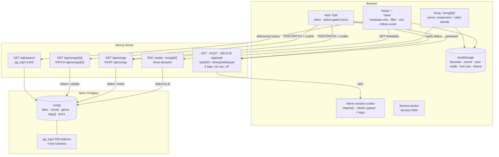
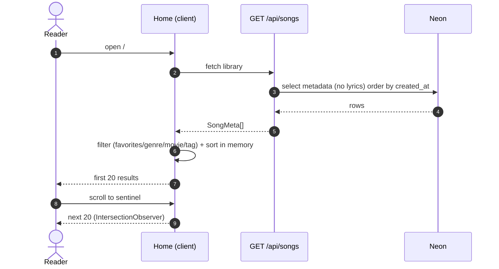
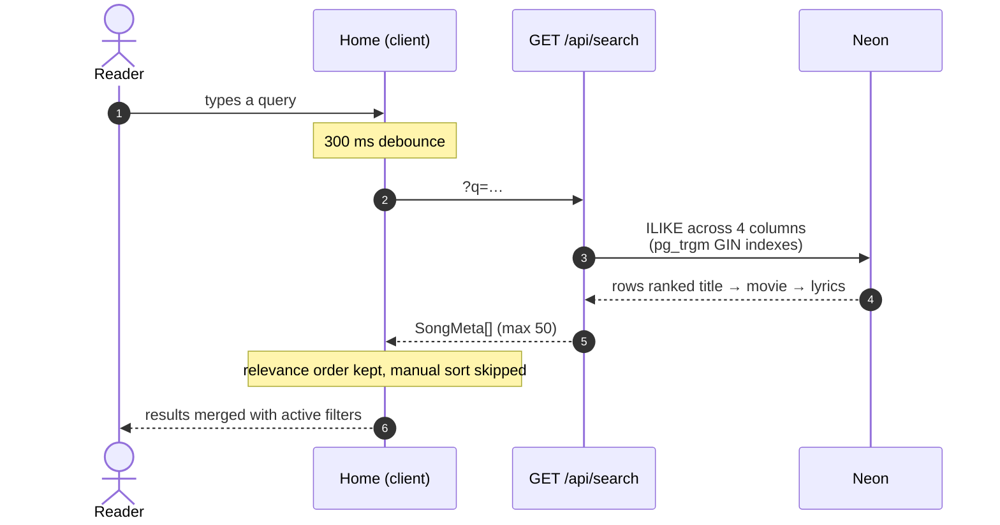
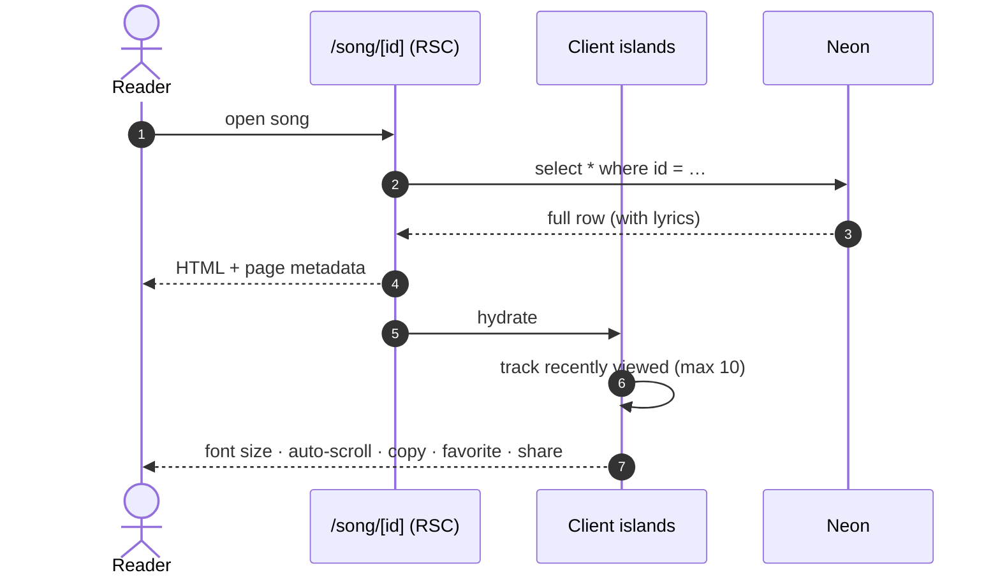
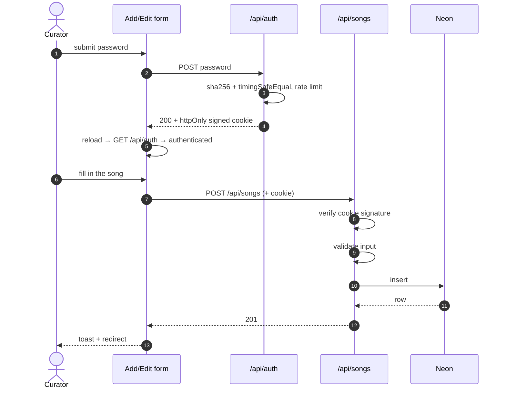
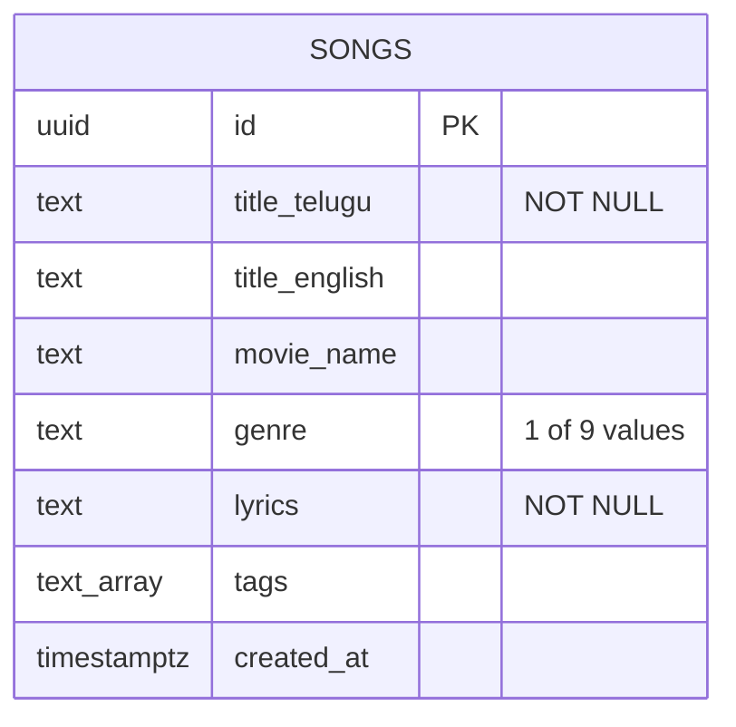

# Telugu Lyrics Vault — Architecture

> Rendered, styled version: open [`architecture.html`](./architecture.html) in a browser.

## System overview

## Flows

### 1. Browse

### 2. Search

### 3. Read a song

### 4. Add / edit

## Data model

Browser-side state, keyed by song `id` — never stored in Postgres:

| Storage | Key | Value |
| --- | --- | --- |
| localStorage | `lyrics-vault-favorites` | array of song IDs |
| localStorage | `lyrics-vault-recent` | last 10 song IDs |
| localStorage | `lyrics-view-mode` | `list` \| `grid` |
| localStorage | `lyrics-font-size-index` | index into 14–32 px |
| localStorage | `theme` | `dark` \| `light` \| `system` |
| cookie (httpOnly) | `lyrics_admin` | HMAC-signed session, 7 days |

## Notes

- **All data access is server-side.** `DATABASE_URL` is never shipped to the client, so there is
  no anon key and no RLS to misconfigure.
- **Search uses `pg_trgm`**, not pgroonga: `ILIKE '%term%'` over four columns with GIN indexes.
  Good to a few thousand songs; ranking is match-location based.
- **Auth is stateless:** the cookie payload is `v1.<expiry>.<hmac>`, verified on every write.
  Rotating `ADMIN_PASSWORD` invalidates all sessions, which is the intended escape hatch.
- **Theme is CSS-variable inversion**, applied before paint by an inline script to avoid a flash.
- **The database is disposable:** `npm run backup` exports everything to `data/songs.json` and
  `npm run import` restores it.
